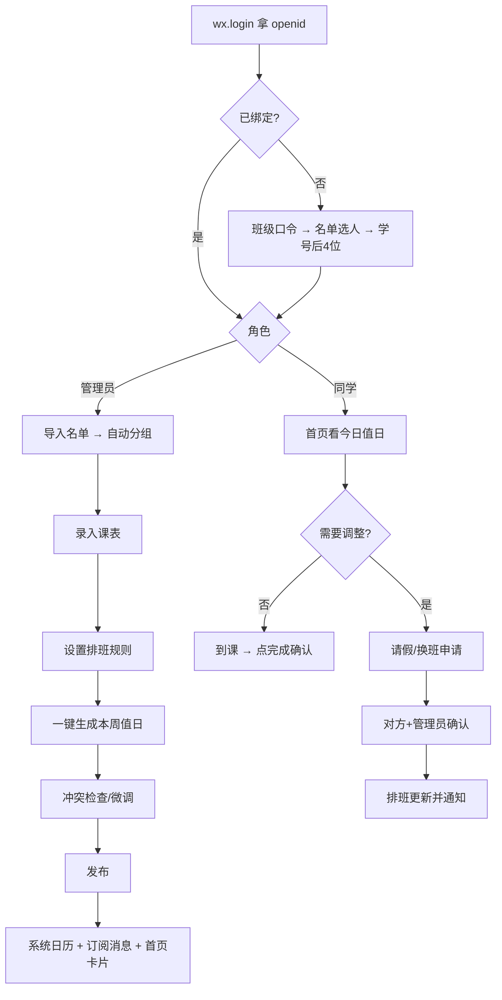
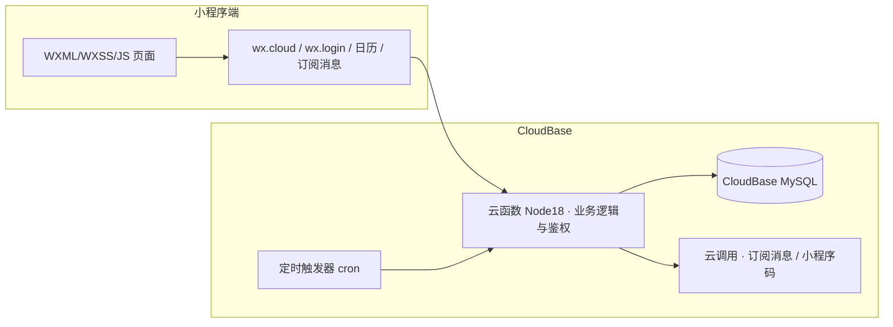

# 班级任务管理 · MVP 需求与可行性方案

| 项目 | 内容 |
|---|---|
| 版本 | v1.0（锁定版） |
| 日期 | 2026-09-23 |
| 形态 | 微信小程序（原生 WXML / WXSS / JS / JSON） |
| 后端 | 腾讯云 CloudBase（云函数 + MySQL + 定时触发器） |
| 范围 | 单班级自用，最多 60 人，**不做多租户** |
| 使用者 | 生活委员（开发者本人）+ 全班同学 |

---

## 0. 决策记录（已确认，作为本文档前提）

| # | 决策项 | 结论 | 影响 |
|---|---|---|---|
| D1 | 是否需要同学端 | **需要**，全班 60 人可见 | 必须正式发布 → 必须备案 + 审核 |
| D2 | 能否接受备案等待（5–7 周） | **可以接受** | 走小程序单轨，不做 H5 双轨 |
| D3 | 打卡是否拍照 | **不拍照** | 砍掉云存储、内容安全审核、相册隐私声明 |
| D4 | 绑定凭证 | **学号后 4 位 + 班级口令** | 不做审批流，身份绑定一次完成 |
| D5 | 是否多班级 | **否**，只服务自己班 | 砍掉建班/邀请/租户隔离 |

**追加约束（V1.0）**：不做文字备注与 UGC，MVP 实现**零用户生成内容**，内容安全整块不触碰，审核风险最低。

---

## 1. 产品需求

### 1.1 产品定位

> 面向大学班级的「课表驱动的轻量值日协作工具」——先把**值日排班**做透，再扩展为通用班委派活。

- 对管理者（生活委员）：每周手搓 Excel 的 30 分钟 → 一键生成 30 秒。
- 对同学：把"今天要不要扫"变成打开就看见的一张卡片。
- 不做社交、不做内容平台、不做商业化。

### 1.2 目标用户与角色

| 角色 | 人数 | 核心诉求 | 权限 |
|---|---|---|---|
| 管理员（生活委员） | 1 | 导入名单课表、生成值日、处理换班请假 | 全部读写 |
| 班委（班长/团支书） | 2–4 | 派活、备注（V1.1） | 建任务、查看全班 |
| 普通同学 | ~55 | 我什么时候值日、确认完成、请假换班 | 只读 + 自身相关操作 |

### 1.3 核心使用场景

| # | 场景 | 频率 | 关键动作 |
|---|---|---|---|
| S1 | 开学建制 | 一学期 1 次 | 导入 60 人名单 → 按学号尾号自动分 A/B 组 → 录入课表 |
| S2 | 每周排班 | 每周 1 次 | 一键生成本周值日 → 微调 → 发布 |
| S3 | 查看今日值日 | 每人每天 | 首页看到"今天第 3 节，A 组，你值日，3 教 401" |
| S4 | 请假/换班 | 偶发 | 提交申请 → 对方确认 → 管理员可见 |
| S5 | 完成确认 | 每次值日 | 点按钮确认完成（**无拍照**） |
| S6 | 班委派活 | 偶发（V1.1） | 选人/选组 → 写备注 → 通知个人 |

### 1.4 MVP 功能边界

**做（P0）**
- 微信登录 + 名单选人 + 学号后 4 位校验 + 班级口令
- 名单导入（粘贴 CSV / Excel）+ 自动 A/B 分组（学号尾号奇偶）+ 手动调组
- 课表录入：周次、星期、节次（上午 1/2、下午 3/4、晚上 5）、课程名、教室、类型（全体 / 分组）
- 分组课规则：单周 A / 双周 B 或按上课次序轮换，支持手动覆盖
- 值日自动生成（轮转算法，避开停用与当日重复）+ 手动调整
- 今日值日卡片、本周值日表（全班可见）
- 换班 / 请假申请与确认
- 完成确认按钮 + 值日次数统计
- 系统日历提醒 + 一次性订阅消息
- 导出本周值日表（图片 / 表格）

**不做（V1.1 及以后）**
- 手动任务派发与文字备注
- 复杂可见性（V1.0 只保留「全班可见 / 仅管理员草稿」）
- 拍照打卡、云存储
- 多班级、教务系统自动同步、奖惩积分

### 1.5 页面清单

| # | 页面 | 核心功能 | 关键交互状态 |
|---|---|---|---|
| P1 | 绑定/启动 | `wx.login` → 班级口令 → 名单选人 → 学号后 4 位校验 → 绑定 openid | 已被绑定、口令错误、验证失败、重复绑定 |
| P2 | 首页·今日 | 今日课次 + **我的值日高亮** + 待办 + 「开启提醒」按钮 | 今天没课 / 没值日、已完成、已过期未确认 |
| P3 | 课表周视图 | 5×5 网格、切换周次、分组课 A/B 徽标 | 加载中、本周无课、单/双周提示 |
| P4 | 本周值日表 | 全班可见，按日 / 按人筛选 | 未发布（草稿同学不可见）、已发布 |
| P5 | 排班管理（管理员） | 一键生成、冲突检查、手动微调、发布 | 同人同日重复、有人请假需补位、未保存离开拦截 |
| P6 | 成员与分组（管理员） | 导入名单、A/B 组、调组、停用、解绑、设为管理员 | 人数不均警告、导入失败行提示 |
| P7 | 我的 | 我的值日次数、完成确认、**添加值日到系统日历**、换班/请假申请 | 无记录、待对方确认 |
| P8 | 关于 / 备案信息 | **展示备案号并链接工信部备案系统**（合规强制） | — |

### 1.6 完整用户流程



### 1.7 关键交互状态

| 对象 | 状态枚举 | 说明 |
|---|---|---|
| 值日 Duty | 未开始 / 进行中 / 已完成 / 已请假 / 已换出 / 已过期未确认 | 过期未确认需有补录入口 |
| 周排班 Week | 草稿 / 已发布 / 已归档 | 草稿期同学不可见 |
| 换班 Swap | 待对方确认 / 待管理员确认 / 已完成 / 已拒绝 / 已撤销 | 必须写 `duty_log` |
| 成员 Member | 正常 / 请假中 / 已停用（转专业） | 停用后不参与排班但保留历史 |
| 绑定 | 未绑定 / 已绑定 / 已解绑 | 一人只能绑一个身份 |

### 1.8 第二阶段（V1.1）功能

1. **统一任务中心**：值日 + 班委派活合并为同一 `Task` 模型，支持截止时间、完成状态、评论。
2. **可见性三档**：全班可见 / 仅自己 / 指定人可见。
3. **公平性看板**：按人统计值日次数、连续值日预警。
4. **课表 OCR 导入**：截图识别教务课表。
5. **学期归档与班委换届交接**：管理员可移交。

---

## 2. 技术可行性评审

### 2.1 总体架构



**核心原则：所有读写走云函数，端上不直连 MySQL。** 角色校验在云函数内完成（`cloud.getWXContext()` 取 openid → 查管理员表），端上不做权限判断。
另外**云函数必须校验来源 AppID / openid 存在**，避免环境 ID 泄露后被直接调用刷库。

### 2.2 数据模型（MySQL DDL 草案）

```sql
-- 单班配置（全局只有一行）
CREATE TABLE class_config (
  id            INT PRIMARY KEY,
  name          VARCHAR(64)  NOT NULL,
  term_start    DATE         NOT NULL COMMENT '学期第一周周一',
  total_weeks   TINYINT      NOT NULL DEFAULT 18,
  join_token    VARCHAR(32)  NOT NULL COMMENT '班级口令',
  period_time   JSON         COMMENT '[{period:1,start:"08:00",end:"08:45"}...]'
) ENGINE=InnoDB DEFAULT CHARSET=utf8mb4;

CREATE TABLE member (
  id            INT AUTO_INCREMENT PRIMARY KEY,
  name          VARCHAR(32)  NOT NULL,
  student_no    VARCHAR(32)  NOT NULL UNIQUE,
  group_tag     ENUM('A','B') NOT NULL COMMENT '学号尾号奇偶',
  role          ENUM('ADMIN','MONITOR','MEMBER') DEFAULT 'MEMBER',
  status        ENUM('ACTIVE','LEAVE','DISABLED') DEFAULT 'ACTIVE',
  openid        VARCHAR(64)  DEFAULT NULL UNIQUE COMMENT '绑定后写入',
  duty_count    INT          DEFAULT 0  COMMENT '累计值日次数，用于轮转排序',
  last_duty_at  DATE         DEFAULT NULL,
  created_at    DATETIME     DEFAULT CURRENT_TIMESTAMP
) ENGINE=InnoDB DEFAULT CHARSET=utf8mb4;

CREATE TABLE course (
  id            INT AUTO_INCREMENT PRIMARY KEY,
  name          VARCHAR(64)  NOT NULL,
  teacher       VARCHAR(32),
  room          VARCHAR(32),
  course_type   ENUM('ALL','GROUP') NOT NULL COMMENT '全体课 / 分组课',
  duty_count    TINYINT      DEFAULT 1 COMMENT '每次课需几人值日'
) ENGINE=InnoDB DEFAULT CHARSET=utf8mb4;

-- 课次：排班的原子单位
CREATE TABLE session (
  id            INT AUTO_INCREMENT PRIMARY KEY,
  course_id     INT          NOT NULL,
  week          TINYINT      NOT NULL,
  day_of_week   TINYINT      NOT NULL COMMENT '1=周一',
  period        TINYINT      NOT NULL COMMENT '1-2上午 3-4下午 5晚上',
  group_scope   ENUM('A','B') DEFAULT NULL COMMENT 'NULL=全体课',
  duty_count    TINYINT      DEFAULT 1,
  class_date    DATE         NOT NULL COMMENT '冗余，便于按日查询',
  UNIQUE KEY uq_slot (course_id, week, day_of_week, period)
) ENGINE=InnoDB DEFAULT CHARSET=utf8mb4;

CREATE TABLE duty (
  id            INT AUTO_INCREMENT PRIMARY KEY,
  session_id    INT          NOT NULL,
  member_id     INT          NOT NULL,
  status        ENUM('PENDING','DONE','LEAVE','SWAPPED_OUT','EXPIRED') DEFAULT 'PENDING',
  source        ENUM('AUTO','MANUAL') DEFAULT 'AUTO',
  created_at    DATETIME     DEFAULT CURRENT_TIMESTAMP,
  UNIQUE KEY uq_duty (session_id, member_id)
) ENGINE=InnoDB DEFAULT CHARSET=utf8mb4;

CREATE TABLE duty_log (
  id            INT AUTO_INCREMENT PRIMARY KEY,
  duty_id       INT          NOT NULL,
  operator_id   INT          NOT NULL,
  action        ENUM('CREATE','SWAP','LEAVE','DONE','UNDO') NOT NULL,
  from_member   INT, to_member INT,
  created_at    DATETIME     DEFAULT CURRENT_TIMESTAMP
) ENGINE=InnoDB DEFAULT CHARSET=utf8mb4;

CREATE TABLE leave_request (
  id            INT AUTO_INCREMENT PRIMARY KEY,
  member_id     INT          NOT NULL,
  start_date    DATE         NOT NULL,
  end_date      DATE         NOT NULL,
  reason        VARCHAR(128),
  status        ENUM('PENDING','APPROVED','REJECTED') DEFAULT 'PENDING'
) ENGINE=InnoDB DEFAULT CHARSET=utf8mb4;
```

**规模估算**：60 人 × 18 周 × 约 20 课次/周 ≈ 2 万条 `duty`/学期，单表无压力。

### 2.3 核心功能技术实现

| 功能 | 实现方式 | 平台限制 / 风险 | 缓解方案 |
|---|---|---|---|
| 登录 | `wx.login` → 云函数换 openid | 无手机号权限（个人主体） | 名单选人 + 学号后 4 位即可 |
| 头像昵称 | 不获取（V1.0 无 UGC，无需头像） | `getUserProfile` 已收回 | 直接用姓名显示 |
| 名单导入 | 管理员粘贴 CSV（先做）/ `wx.chooseMessageFile` 选 xlsx → 云函数 `exceljs` 解析 | 端上不能解析二进制，云函数内存需调到 512MB | V1.0 先做粘贴 CSV，Excel 导入放 V1.1 |
| 分组 | 学号尾号 `% 2` 自动打标，可手动覆盖 | 可能 29/31 不均 | 分组页显示人数并警告 |
| 课表录入 | 表单录入 + 「复制上周」+ CSV 导入 | 教务系统无接口 | 明确"首次录入 10–20 分钟" |
| 自动排班 | 云函数轮转算法（见 2.6） | 公平性是主观感受 | 支持"重新生成" + 手动覆盖 + 次数公开 |
| 定时生成 | 云函数 `config.json` cron（每周日 20:00 生成下周） | 冷启动 300–800ms | 幂等设计，重复执行不产生脏数据 |
| 提醒 | 见 2.7 | 长期订阅消息无权限 | 日历 + 一次性订阅 + 首页卡片 |
| 导出 | 云函数生成表格 / 端上 Canvas 绘图 | Canvas 长图 iOS 内存限制 | 分段绘制，超长时改导出文件 |

### 2.4 微信平台硬限制（不可协商）

| # | 限制 | 影响 |
|---|---|---|
| 1 | 体验成员上限：个人主体约 **10–15 人**，且**个人主体不支持微信认证**（无法提额） | 60 人必须用**正式版**；开发期只能自测 + 约 14 人内测 |
| 2 | 长期订阅消息仅限政务/医疗/交通/金融 | 校园场景申请不到，别浪费时间 |
| 3 | `wx.requestSubscribeMessage` 必须在用户点击事件的同步调用链中触发 | 「开启提醒」必须做成按钮 |
| 4 | `wx.addPhoneRepeatCalendar` 需 `scope.addPhoneCalendar` 授权，**必须由 tap 触发**，重复周期仅 day/week/month/year | 无法表达"每两周"，见 2.7 设计调整 |
| 5 | 主包 ≤ 2MB，总包 ≤ 20MB | 原生开发充足 |
| 6 | 备案通过后**必须在页面展示备案号并链接工信部系统** | 新增 P8 页面 |
| 7 | 个人主体不可微信认证、不可支付、不可营销 | 本方案不涉及，安全 |

### 2.5 无法实现的需求与落地调整

| 原需求 | 阻断原因 | 落地调整 |
|---|---|---|
| 每周自动推送下周值日 | 无长期订阅消息权限 | 系统日历（周重复）+ 一次性订阅消息 + 首页卡片，三件套分工 |
| 精确提醒"某节课该你值日"（日历维度） | 日历 API 无"每两周"，单双周分组课无法一条表达；逐条写入要弹几十次窗 | 日历只写 1 条"每周查看本周值日"；精确提醒交给订阅消息 |
| 自动同步教务课表 | 无接口，且涉及账号凭据合规风险 | 手动录入 + CSV 导入；OCR 放 V1.1 |
| 端上直连 MySQL 做权限过滤 | 端上凭据泄露 = 全库暴露 | 全部走云函数鉴权 |
| 个人主体微信支付 | 不支持 | 本方案无支付需求 |
| 静默获取订阅授权 | 接口必须由用户点击触发 | 放在"发布排班成功页"和 P7「开启提醒」按钮 |

### 2.6 排班算法设计

```
generateDuty(weekStart, weekEnd):
  for each session where week in [weekStart, weekEnd] and class_date not holiday:
      candidates = session.group_scope is NULL
                   ? members(status=ACTIVE)
                   : members(status=ACTIVE and group_tag = session.group_scope)
      candidates = candidates
                   - 当日已有 duty 的人          # 避免一天排两次
                   - 请假中的人（leave_request APPROVED）
      sort candidates by (duty_count ASC, last_duty_at ASC, random tiebreak)
      pick top N = session.duty_count
      insert duty(source=AUTO) 且幂等（UNIQUE(session_id, member_id)）
      更新 member.duty_count / last_duty_at
      写 duty_log
```

要点：
- **幂等**：`UNIQUE(session_id, member_id)` + 生成前先删除本周 `source=AUTO` 的旧记录，重复执行不产生脏数据。
- **公平性**：`duty_count` 与 `last_duty_at` 双键排序，随机打破平局，避免长期固化。
- **冲突**：同日重复在候选过滤阶段就排除；若候选不足（如 A 组人少且多人请假），返回"候选不足"告警给管理员手动处理。

### 2.7 提醒方案（三件套）

| 通道 | 职责 | 粒度 | 实现 |
|---|---|---|---|
| **系统日历** | 提醒"去看本周值日" | 1 条，`repeatInterval: week`，`repeatEndTime` = 学期末 | `wx.addPhoneRepeatCalendar`，用户点击按钮触发 |
| **订阅消息** | 精确提醒具体某次值日、换班、临时任务 | 具体课次 | `wx.requestSubscribeMessage` 攒额度后云函数调用下发 |
| **首页卡片** | 打开即见今天有没有值日 | 当天 | 常规页面 |

分工理由：日历负责"记得来看"，订阅消息负责"精确提醒"，首页负责"不用记"。绕开日历 API 无法表达单双周的限制。

### 2.8 内容安全与隐私合规

| 项 | 要求 | 本方案状态 |
|---|---|---|
| ICP 备案 | 个人主体可备案；周期约 **7–20 个工作日** | **必须做，第 1 天提交** |
| 备案号展示 | 页面展示备案号并链接 `beian.miit.gov.cn` | **P8 页面** |
| 隐私保护指引 | mp 后台强制配置 | 需配置（声明学号、微信 openid） |
| 用户协议 / 隐私政策 | 小程序内需可访问入口 | P8 内提供 |
| 内容安全检测 | 有 UGC 才需要 | **V1.0 零 UGC，不做** |
| 类目选择 | 与业务一致 | 选 **「工具 → 效率」**，避开"教育"（触发前置审批） |
| 测试账号 | 首次提审大概率打回要求提供 | 提前准备 1 个可登录测试学号 |

**备案流程与两个翻车点**：
1. 填资料 → 平台初审 1–3 工作日 → **工信部短信核验（必须 24 小时内完成，超时直接驳回）** → 管局终审 3–20 工作日。
2. 个人主体名下**最多备案 5 个小程序**，勿浪费名额。

### 2.9 主要风险与对策

| 风险 | 等级 | 对策 |
|---|---|---|
| 备案/类目被拒，上线延后 | 高 | 第 1 天提交；类目选工具类；简介避开"教育/校园/教学" |
| 课表首次录入成本高导致弃用 | 高 | CSV 导入 + 复制上周；邀请 1–2 名班委分工录入 |
| 提醒触达不到，产品感知弱 | 高 | 三件套分工；发布排班成功页强引导开启 |
| 分组人数不均引发争议 | 中 | 分组页可视化 + 手动调组 |
| 排班被认为"不公平" | 中 | 次数统计对全班公开；管理员可手动覆盖 |
| 云函数并发打爆 MySQL 连接 | 低 | 60 人并发极低；仍配置连接池上限 |
| 正式版公开，陌生人可打开 | 中 | **班级口令**作为唯一入班门槛 |

---

## 3. 排期与验收

### 3.1 排期

| 周 | 开发任务 | 并行关键路径 |
|---|---|---|
| **W0** | 注册小程序、选类目、**提交备案** | 备案 7–20 工作日（最长项） |
| W1 | 数据模型 + CloudBase 环境 + 绑定流程 + 名单导入分组 | |
| W2 | 课表录入 + 周视图 + 单双周规则 | |
| W3 | 排班算法 + 值日表 + 首页今日卡片 | |
| W4 | 提醒三件套 + 完成确认 + 统计 + 导出 | |
| W5 | P8 备案号页 + 隐私指引 + 测试账号 + 提审 + 修复 | 审核 1–3 天 |

**实际开发工作量约 4 周；上线时间由备案决定，总日历周期约 5–7 周。**

### 3.2 验收标准

| 类别 | 标准 |
|---|---|
| 功能 | P1–P8 全部可用；60 人 × 18 周数据下首屏 < 1.5s |
| 绑定 | 60 人各自绑定成功；重复绑定被拦截；冒名无法绑定他人 |
| 算法 | 生成一周值日无重复冲突；请假者不被排入；同一人同日最多 1 次 |
| 幂等 | 定时云函数重复执行 3 次不产生重复 `duty` |
| 权限 | 普通同学调用管理员云函数返回 403；端上无法直接读写 MySQL |
| 提醒 | 日历事件写入成功且按周重复；订阅消息点击后成功下发一条 |
| 合规 | 备案通过、审核通过、隐私指引已配、备案号已在 P8 展示 |

---

## 4. 开工前 Checklist（无需写代码）

- [ ] **今天**：mp 后台注册小程序 → 设置 → 小程序备案 → 提交；提交后盯手机，**24 小时内完成工信部短信核验**
- [ ] 类目选 **「工具 → 效率」**，简介写"班级日程与值日安排工具"
- [ ] 备齐材料：身份证正反面、纯白底免冠照、未占用名额的邮箱
- [ ] 导出全班名单（姓名 + 学号）与本学期课表
- [ ] 明确每门分组课的组别规则（单周 A / 双周 A），列成一张表
- [ ] 设定班级口令

---

## 5. 下一步交付顺序

1. 建表 SQL 落地 + CloudBase 环境初始化说明
2. 排班算法云函数（单双周规则、冲突检测、幂等）
3. 小程序端四个核心页：绑定 → 课表录入 → 一键排班 → 值日表
4. 提醒三件套 + P8 备案号页 + 隐私指引文案

---

## 附：V1.0 明确不做清单

多班级 / 租户隔离 · 邀请审核流 · 复杂角色权限矩阵 · 可见性三档 · 拍照打卡与云存储 · 内容安全检测 · 文字备注与班委派活 · 教务系统同步 · 微信支付 · OCR 导入
